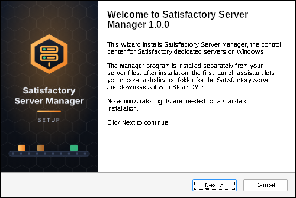

# Satisfactory Server Manager

A Windows desktop control center for **Satisfactory dedicated servers**
(Steam App 1690800): guided installation, live monitoring, interactive
console, backups, updates, FICSIT mods, scheduling and optional secure remote
management — built with Electron.



## Highlights

- **Custom Windows installer** — branded, per-user (no administrator rights),
  license agreement, folder choice, optional desktop shortcut, launch on finish,
  Apps & Features registration. See [docs/INSTALLER.md](docs/INSTALLER.md).
- **First-launch setup assistant** — checks the PC, lets you choose the server
  folder (always separate from the program folder), downloads SteamCMD from
  Valve, installs the dedicated server (public or experimental branch),
  checks ports and Windows Firewall, claims the server through the official API
  and resumes safely after interruptions.
- **Multi-server dashboard** with real process CPU/RAM, uptime, player counts
  (via the server HTTPS API), build, mods, last backup and quick actions.
- **Console** with live output, history, filters, search, log levels, per-run
  logs, exit codes and crash reasons.
- **Crash recovery** with restart policies, cooldown/backoff, loop prevention
  and automatic diagnostics packages — only for processes the manager owns.
- **Update center**, **scheduler** (time-zone aware cron), **backup browser**
  (SHA-256 + CRC32 validated, restore points), **storage analyzer**,
  **diagnostic assistant** with verified repairs, **migration** (encrypted,
  checksummed packages), **configuration profiles & templates**,
  **performance reports**, **notification center** and **activity timeline**.
- **FICSIT mod manager** — dedicated-server builds only, dependency resolution,
  conflict detection, SHA-256 verified downloads from ficsit.app, rollback.
- **Optional web dashboard and remote management** — off by default, local
  network only, TLS, scrypt passwords, CSRF protection, paired device tokens.

No metric is ever estimated: values that cannot be measured are shown as
“not available”.

## Requirements

- Windows 10 (1809) / Windows Server 2019 or newer, 64-bit
- 12–16 GB RAM recommended for the dedicated server, ~15 GB free disk space
- Internet access to Steam (SteamCMD) and, for mods, ficsit.app

## Development

```bash
npm install
```

```bash
npm start
```

```bash
npm test
```

```bash
npm run lint
```

End-to-end tests drive the real Electron app with Playwright (installed
globally in CI images):

```bash
node test/e2e/run-e2e.js
```

```bash
node test/e2e/pages-smoke.js
```

Build the Windows installer (on Windows, or on Linux with Wine):

```bash
npm run dist:win
```

Regenerate branding assets (icon, installer artwork) from vector sources:

```bash
npm run assets
```

## Documentation

- [Installer and first-run experience](docs/INSTALLER.md)
- [Windows test instructions](docs/WINDOWS_TESTING.md)
- [Architecture](docs/ARCHITECTURE.md)
- [Security](docs/SECURITY.md)

## License

Copyright © 2026 SuperSeller100X. Satisfactory Server Manager is
**proprietary software** licensed under the
[Satisfactory Server Manager Proprietary Non-Commercial License](LICENSE):
free for personal, private, non-commercial use; commercial use,
redistribution, resale, sublicensing and reuse of the source code are not
permitted without written permission. Third-party components keep their own
licenses — see [THIRD_PARTY_NOTICES.md](THIRD_PARTY_NOTICES.md).

Satisfactory is a trademark of Coffee Stain Studios AB. Steam and SteamCMD are
trademarks of Valve Corporation. This project is not affiliated with or
endorsed by Coffee Stain Studios or Valve.
