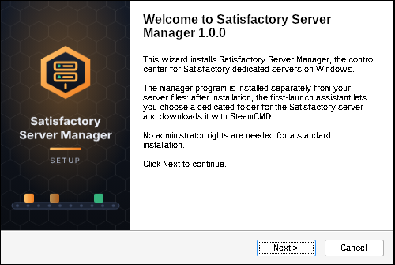
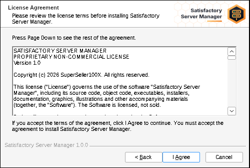
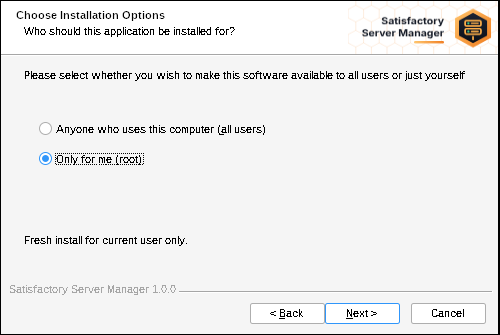
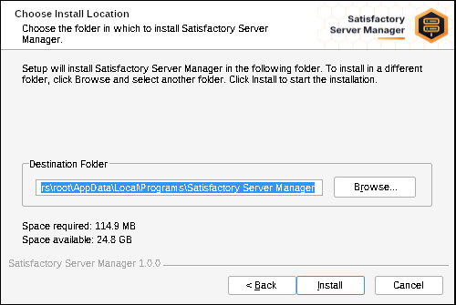
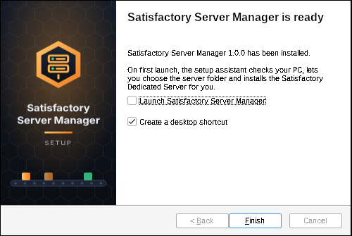
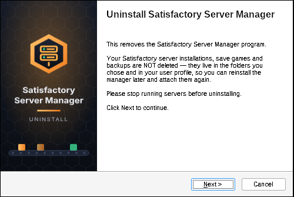

# Installer and first-run experience

Satisfactory Server Manager has two separate setup experiences:

1. **The Windows installer** installs the *manager program*.
2. **The first-launch setup assistant** (inside the app) installs and
   configures the *Satisfactory Dedicated Server*.

The program folder and the server folder are always different. The assistant
refuses server folders inside the program folder, the manager's data folder,
the SteamCMD folder, Windows/Program Files, a drive root, or any folder that
overlaps another configured server.

## 1. Windows installer (NSIS)

Built by electron-builder from `package.json → build.nsis` plus the custom
script `build/installer.nsh`.

| Page | Details |
| --- | --- |
| Welcome | Custom title and text (`customWelcomePage`), branded sidebar artwork |
| License | Shows the actual `LICENSE` file; must be accepted |
| Install mode | Defaults to **Only for me** (per-user, no administrator rights). “Anyone who uses this computer” is optional and triggers UAC |
| Directory | Default `%LOCALAPPDATA%\Programs\Satisfactory Server Manager`; can be changed |
| Progress | Standard progress page with branded header |
| Finish | “Launch Satisfactory Server Manager” (checked) and “Create a desktop shortcut” (unchecked, opt-in) |

Also:

- **Start Menu shortcut** is always created.
- **Apps & Features** registration under
  `HKCU\Software\Microsoft\Windows\CurrentVersion\Uninstall\<GUID>` (per-user
  install): DisplayName, DisplayVersion, Publisher, DisplayIcon,
  UninstallString, QuietUninstallString, EstimatedSize.
- **Uninstaller** with its own branded welcome page explaining that server
  installations, saves and backups are *not* deleted. It removes the program,
  shortcuts (including the optional desktop shortcut) and the optional
  start-at-sign-in entry. User data (`%APPDATA%\Satisfactory Server Manager`,
  `%LOCALAPPDATA%\SatisfactoryServerManager`) is kept
  (`deleteAppDataOnUninstall: false`).
- Branding: `BrandingText`, icon (`build/icon.ico`, 16–256 px), sidebar
  (`build/installerSidebar.bmp`, `build/uninstallerSidebar.bmp`, 164×314) and
  header (`build/installerHeader.bmp`, 150×57). All generated from vector
  sources by `scripts/build-assets.js` (`npm run assets`).

Artifacts (`npm run dist:win`):

- `dist/SatisfactoryServerManager-Setup-<version>.exe` — installer
- `dist/SatisfactoryServerManager-<version>-x64.zip` — portable archive

Screenshots (captured from the real installer under Wine):

| | |
| --- | --- |
|  |  |
|  |  |
|  |  |

### Code signing

The build is **not code-signed** (no certificate is configured). Windows
SmartScreen will show “Windows protected your PC” for unsigned downloads;
users choose *More info → Run anyway*. Configure `win.signtoolOptions` /
`CSC_LINK` with a real certificate before public distribution.

## 2. First-launch setup assistant

Shown automatically when the manager starts for the first time (and from
**Add server** / *Settings → General → Run setup assistant again*).

| Step | What happens |
| --- | --- |
| 1. Welcome | Explains the app; shows a recovery banner if a previous run was interrupted |
| 2. Check this PC | Windows version/architecture, RAM, CPU, free disk space, SteamCMD, Microsoft Visual C++ runtime, existing server installations (Steam libraries), credential storage |
| 3. Server folder | New install or attach an existing one. Suggested folder `%USERPROFILE%\SatisfactoryServers\Server`; live validation (writable, empty, free space, path length, not a protected/overlapping folder); **game and reliable ports** prefilled with a free pair and checked live (in use by another program or another server, identical ports) with a one-click “Use free ports”; branch choice (public / experimental, from Steam's published branches); **explicit confirmation checkbox** |
| 4. Prerequisites | Downloads SteamCMD from Valve's official CDN and runs its self-update; optionally installs the Microsoft Visual C++ 2015–2022 runtime from `aka.ms` after verifying Microsoft's Authenticode signature (one UAC prompt) |
| 5. Install server | `steamcmd +force_install_dir <folder> +login anonymous +app_update 1690800 [-beta experimental] validate +quit` with live progress parsed from SteamCMD; verified via `appmanifest_1690800.acf` (fully installed) and the server executable |
| 6. Network | Port conflict check (UDP/TCP game port, TCP reliable port) with suggested free ports; Windows Firewall inspection; creates inbound rules after confirmation (one UAC prompt); router port-forwarding explained with an official link |
| 7. Security | **One click: “Set up automatically”.** Starts the server if needed, then uses the official HTTPS API: *PasswordlessLogin → ClaimServer* with a strong generated administrator password (or one you choose), *RunCommand server.GenerateAPIToken* for a long-lived API token (also captured from the server console if the server prints it there), *VerifyAuthenticationToken*. Token and admin password are stored encrypted (DPAPI); the generated password is shown once and can be revealed later on the server's Access tab. Already-claimed servers ask for the existing admin password once. Invalidated tokens are renewed automatically. Can be skipped |
| 8. Review | Summary and timeline of completed operations |
| 9. Finish | Start the server now, auto-start with the manager, optional start-at-sign-in |

### Persistence, recovery and safety

- Progress is stored in the database (`settings` row `setup`) after every change.
- Completion is **verified against the real system** on every load (SteamCMD
  binary, Steam manifest, server executable, firewall rules, stored token), so
  finished work is never repeated and stale flags cannot lie.
- Long operations record an *active operation*. If the app closes or crashes,
  the next start shows “Setup was interrupted” and offers to resume (SteamCMD
  keeps downloaded parts) — or, for a folder the assistant created itself
  (marker file `.ssm-install`), to remove the partial files.
- Partial installations (interrupted download, incomplete manifest, missing
  executable, wrong branch) are detected and repaired with `validate`.
- **Cancel** stops SteamCMD safely; closing the app also stops SteamCMD.
- Errors are translated into plain language (disk full, permission denied,
  network/Steam unreachable, branch refused) with what to do next.
- Steps can be revisited from the progress rail; forward navigation requires
  the previous steps to be verified.

### Unavoidable manual actions

- **UAC prompts** for firewall rules and the Visual C++ runtime (Windows
  requires administrator approval; the manager asks first).
- **Router port forwarding** for players outside the local network — cannot be
  automated; explained with a link to the
  [official dedicated server guide](https://satisfactory.wiki.gg/wiki/Dedicated_servers).
- **The existing administrator password**, only for a server that was claimed before the manager was used (entered once).
